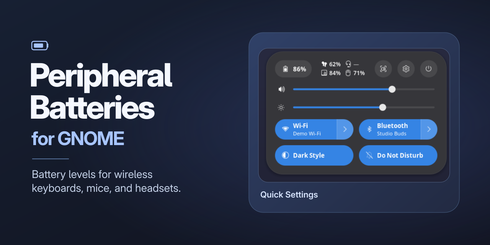
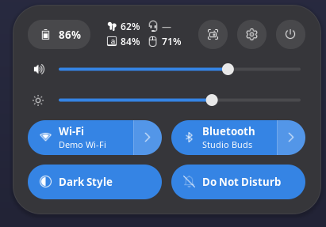
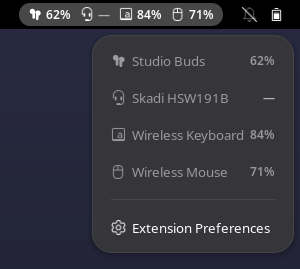
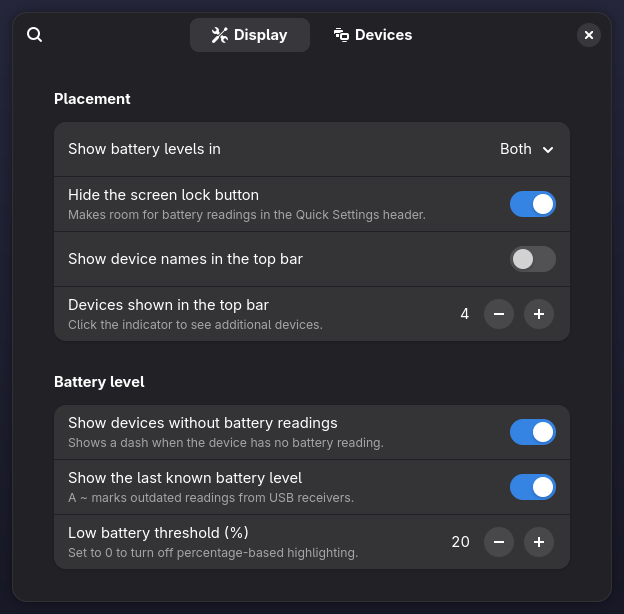
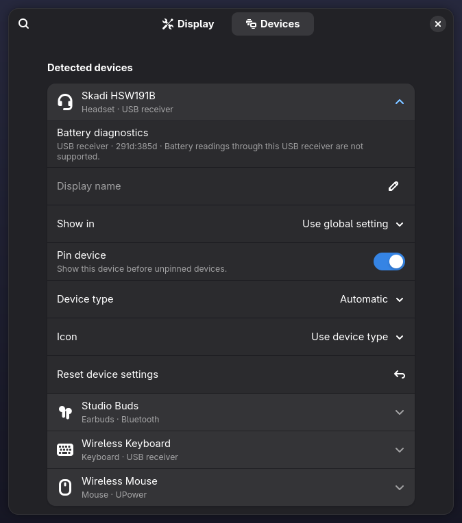

# Peripheral Batteries for GNOME

[Українською](#українською)

Monitor battery levels for wireless keyboards, mice, and headsets in GNOME Quick Settings or the top bar. Peripheral Batteries reads data from Bluetooth, UPower, and supported 2.4 GHz USB receivers. Customize each device’s name, icon, type, and placement, pin the ones you use most, and use battery diagnostics to see why a reading is missing.



| Quick Settings | Top bar |
| --- | --- |
|  |  |

### Preferences

| Display settings | Device diagnostics and pinning |
| --- | --- |
|  |  |

Screenshots show GNOME Shell 51.1 with sample devices and readings.

## Requirements

- GNOME Shell 51. The extension has been tested on GNOME Shell 51.1.
- UPower for batteries reported by Linux and BlueZ for Bluetooth devices.
- Python 3 for the bundled USB receiver monitor. Some receivers require user access to their specific HID interface.

## Install

Download `peripheral-batteries@stas.local.shell-extension.zip` from [Releases](https://github.com/stasbelia/gnome-peripheral-batteries/releases) or [build it from source](#build-an-installable-zip). From the directory containing the ZIP, run the following command.

```sh
gnome-extensions install --force peripheral-batteries@stas.local.shell-extension.zip
```

Log out of GNOME and back in. Enable **Peripheral Batteries** in the Extensions app or run `gnome-extensions enable peripheral-batteries@stas.local`.

Open the extension preferences from the Extensions app or with `gnome-extensions prefs peripheral-batteries@stas.local`. The interface follows the GNOME session language and is available in English and Ukrainian. Turn on **Hide the screen lock button** on the **Display** page to make room for readings in Quick Settings. This switch starts off. Screen lock remains available through GNOME’s keyboard shortcut.

## Device support

| Connection or device | What is available |
| --- | --- |
| Bluetooth and UPower | Battery levels where the device and Linux expose them, including readings for unclassified UPower devices. Device types can be corrected in preferences. |
| AULA F75 receiver (`3554:fa09`) | Battery percentage with read/write access to its telemetry interface. |
| Attack Shark X11 receiver (`1d57:fa60`) | Battery percentage from passive reports with read access to its telemetry interface. |
| Skadi HSW191B receiver (`291d:385d`) | Headset detection. The USB battery protocol for this model is unverified. |

A dash marks a device with no reading to display. Open **Devices → the device → Battery diagnostics** to see the source, the receiver's USB ID when available, and an explanation. A tilde marks the last known USB battery value. For a USB receiver that is missing from the list, check the connection type and USB ID with `lsusb`. Include the model, USB ID, GNOME version, and connection mode in a bug report.

### Optional USB permissions

If Linux denies access to the AULA or Attack Shark telemetry interface, a system administrator can add the applicable rule below to `/etc/udev/rules.d/71-peripheral-batteries.rules`. These matches target the tested USB IDs and interfaces. Skip rules that are already installed.

```udev
SUBSYSTEM=="hidraw", ATTRS{modalias}=="usb:v3554pFA09*in01", TAG+="uaccess"
SUBSYSTEM=="hidraw", ATTRS{modalias}=="usb:v1D57pFA60*in02", TAG+="uaccess"
```

Reload udev rules with `sudo udevadm control --reload-rules`, then unplug and reconnect the receiver. The extension runs under the desktop user account.

## Build an installable ZIP

Run this from the source directory with the GNOME Extensions CLI and GNU gettext installed.

```sh
gnome-extensions pack --force \
  --podir=po \
  --extra-source=devices.js \
  --extra-source=settings.js \
  --extra-source=system-batteries.js \
  --extra-source=telemetry.js \
  --extra-source=monitor.py \
  --extra-source=icons
```

## Українською

**Заряд периферії** показує заряд бездротових клавіатур, мишей і гарнітур у швидких налаштуваннях GNOME або на верхній панелі. Розширення отримує дані через Bluetooth, UPower і підтримувані USB-приймачі 2,4 ГГц. Для кожного пристрою можна змінити назву, іконку, тип і місце показу, закріпити його та дізнатися, чому рівень заряду недоступний. Перевірено на GNOME Shell 51.1.

1. Завантажте ZIP зі [сторінки релізів](https://github.com/stasbelia/gnome-peripheral-batteries/releases) або [зіберіть його з вихідного коду](#build-an-installable-zip). Встановіть ZIP командою `gnome-extensions install --force peripheral-batteries@stas.local.shell-extension.zip`.
2. Вийдіть із сеансу GNOME й увійдіть знову. У застосунку **Розширення** ввімкніть **Peripheral Batteries**. Мова меню й налаштувань визначається мовою сеансу GNOME.
3. Відкрийте **Налаштування → Показ → Ховати кнопку блокування екрана**, якщо хочете звільнити місце у швидких налаштуваннях. За замовчуванням перемикач вимкнений.
4. На вкладці **Пристрої** відкрийте потрібний пристрій. **Діагностика заряду** пояснює, чому показано прочерк. **Закріпити пристрій** переміщує його на початок списку заряду.

Рівень заряду залежить від пристрою та способу підключення. Bluetooth і UPower показують заряд, коли пристрій передає його системі. Для USB-приймачів підтримка залежить від моделі. Перелік перевірених моделей і правила доступу наведено вище.

## Contributors

- OpenAI Codex
